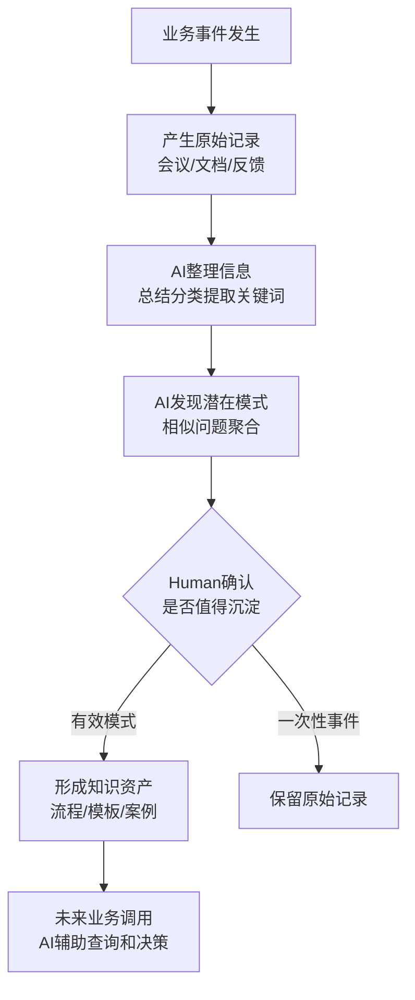

# Case 01｜知识库不是资料堆积：从信息存储到 AI 可调用工作流

**能力标签：Knowledge Workflow**

> **说明**：这是一个基于知识工作流设计的练习案例，团队和场景是假设的，不是真实项目交付经历。
>
> 用来展示我在“如何让分散信息经过 AI 加工，转化为可复用知识资产”这一过程中的判断方式。

---

## 问题场景

一个团队长期积累大量业务资料：

- 项目文档
- 会议记录
- 客户反馈
- 问题处理记录
- 行业资料

团队希望通过 AI 知识库提升工作效率。

但实际使用过程中发现：

- 搜索资料时仍然找不到关键答案
- AI 总结内容只是复述已有信息，没有形成经验
- 相似问题不断重复解决
- 过去项目中的判断和经验无法复用

团队的问题并不是：

> “资料太少。”

而是：

> “信息没有经过加工，无法成为 AI 可以理解和调用的知识。”

---

## 核心判断

很多知识库建设停留在：

```
事件记录
↓
存储
↓
搜索
```

但真正可复用的知识需要：

```
事件
↓
信息整理
↓
模式提炼
↓
知识结构化
↓
AI 调用
↓
业务复用
```

区别在于：

**记录发生过什么，不等于知道下一次应该怎么做。**

---

# AI Workflow 设计

## 原始信息 → 可调用知识

| 阶段 | AI 可以介入什么 | Human 需要判断什么 |
|-|-|-|
| 信息收集 | 整理会议记录、提取关键内容、归档资料 | 哪些信息值得进入知识体系 |
| 内容整理 | 总结、分类、生成标签、发现重复内容 | 分类方式是否符合业务习惯 |
| 模式发现 | 从多个案例中提取相似问题和处理方式 | 这个模式是否真的具有复用价值 |
| 知识生成 | 生成知识卡片、FAQ、流程说明 | 内容是否准确、是否符合实际经验 |
| 知识调用 | 根据问题检索相关经验、辅助回答 | 最终业务判断和决策 |

---

# 一个具体场景

## 原始记录

过去三个项目中都出现：

> 客户需求频繁变更，导致开发延期。

三个项目记录：

项目 A：

- 客户需求理解不一致
- 后期大量修改

项目 B：

- 关键负责人未参与确认
- 上线前发现遗漏

项目 C：

- 需求文档没有明确验收标准

---

## AI 处理

AI 可以发现：

> 三个项目表面问题不同，但可能都属于“需求确认机制不足”。

并生成：

```
问题模式：
需求变更风险

常见表现：
- 需求理解不一致
- 缺少关键人确认
- 验收标准不明确

建议动作：
- 增加需求确认节点
- 明确验收标准
- 提前识别变更风险
```

---

## Human 判断

但 AI 不能直接决定：

> “以后所有项目都必须增加这个流程。”

因为需要判断：

- 这个问题是否高频？
- 是否值得改变现有流程？
- 是否适用于其他团队？
- 是否只是某一次特殊情况？

所以：

> AI 负责发现可能的模式，人负责确认哪些经验值得成为组织知识。

---

# Workflow 设计



---

# AI 与 Human 边界

知识库建设中，AI 最大价值不是：

> 替团队决定什么是知识。

而是：

> 降低从大量信息中发现规律的成本。

## AI 适合：

- 信息整理
- 内容摘要
- 分类聚合
- 模式初步发现
- 知识卡片生成

## Human 必须参与：

- 判断经验是否可复用
- 确认知识是否准确
- 决定是否改变业务流程
- 承担最终决策责任

---

# 交付物

一个 AI Knowledge Workflow 最终交付的不是一个资料库，而是一套：

| 交付物 | 作用 |
|-|-|
| 信息收集规范 | 确保输入质量 |
| 知识整理模板 | 统一表达方式 |
| 模式提炼流程 | 从事件发现经验 |
| AI 调用方式 | 支持日常工作 |
| 知识维护机制 | 保持长期有效 |

---

# 与其他案例的关联

这个案例关注：

> 信息如何变成 AI 可以使用的知识。

它与 AI Agent Delivery Casebook 的逻辑一致：

- Case 01：判断 AI 在业务流程中的角色边界
- Case 02：发现真实业务流程与制度流程的差异
- Case 03：验证 AI 是否具备上线条件

而 Knowledge Workflow 关注的是另一类问题：

> 在 AI 参与工作之前，企业是否已经拥有可被 AI 理解和调用的知识基础。

---

# 局限与下一步

- 本案例目前验证的是知识加工流程设计，还未使用真实团队数据验证 AI 提炼模式的准确性。
- “什么样的经验值得沉淀”为核心判断点，需要结合具体业务建立标准。
- 后续可以进一步探索知识生命周期管理：
  - 新知识如何进入
  - 旧知识如何更新
  - 冲突知识如何处理
```
